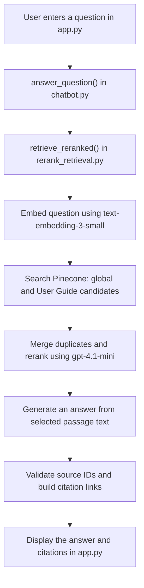

# Documentation RAG Assistant

A Python application that answers questions using Amazon Bedrock documentation and additional public HTML pages. It uses LangChain, OpenAI models, Pinecone, and a Streamlit UI. Answers include clickable links to retrieved sources.

## Deployment options

### Run your own installation

Someone who downloads this repository and runs an independent copy supplies their own:

- OpenAI API key with available credits.
- Pinecone account, API key, and **one dense-vector index** configured with **1536 dimensions** and **cosine similarity**.
- Local `.env` configuration, or equivalent environment variables on their server.

Follow the setup sections below, then add documents through **Add URL** or run bulk ingestion before asking questions. Downloading the source code does not copy the original author's API keys, Pinecone records, or local document caches.

The same index holds both the bulk documentation and URL uploads. The application creates its `bedrock-sections-v2` namespace on the first upload; it does not create the index automatically. Index ownership and usage charges belong to the person running the installation.

### Offer one shared hosted application

If an operator hosts the application for others, the operator configures and pays for the OpenAI and Pinecone accounts. End users access the hosted UI and **do not need their own API keys or Pinecone indexes**.

For this arrangement:

- Keep API keys on the server using environment variables or a private server-side `.env` file.
- Run the Streamlit application on the hosting server and preserve its writable `data/` directory for caches and upload checkpoints.
- Add authentication, access controls for URL ingestion, and usage limits before offering a public service.
- Implement user-specific data isolation if documents must be private to individual users. The current application searches a shared namespace; it does not isolate one user's uploads from another user's searches.

The repository currently provides a local prototype, not a complete authenticated hosting platform. The remaining sections describe installing and running that prototype.

## 1. Prerequisites

You need:

- Python **3.11 or later**. The commands below use Python 3.11.
- [uv](https://docs.astral.sh/uv/getting-started/installation/) to install dependencies and run the application.
- An [OpenAI API key](https://platform.openai.com/api-keys) with available API credits.
- A [Pinecone account and API key](https://app.pinecone.io/), plus an index configured as described below.
- Internet access for documentation downloads, OpenAI, and Pinecone.

Install uv if necessary.

macOS / Linux:

```bash
curl -LsSf https://astral.sh/uv/install.sh | sh
```

Windows PowerShell:

```powershell
powershell -ExecutionPolicy ByPass -c "irm https://astral.sh/uv/install.ps1 | iex"
```

Restart your terminal after installing, then check:

```bash
uv --version
```

These commands follow the [official uv installation instructions](https://docs.astral.sh/uv/getting-started/installation/).

## 2. Install project dependencies

Download or clone this repository. Open a terminal in the project folder containing `pyproject.toml`, then run:

```bash
uv sync --locked --python 3.11
```

This creates `.venv` and installs the versions recorded in `uv.lock`. You do not need to activate the virtual environment when using `uv run`.

## 3. Configure Pinecone

In the [Pinecone console](https://app.pinecone.io/), create an index with these settings:

| Setting | Value |
| --- | --- |
| Name | `bedrock-docs` (or your own name) |
| Index type | Dense vector / bring your own vectors |
| Dimensions | **1536** |
| Similarity metric | **cosine** |
| Deployment | Serverless in a supported cloud/region |

The application generates embeddings with OpenAI and uploads the vectors itself. Follow Pinecone's [index creation guide](https://docs.pinecone.io/guides/index-data/create-an-index) for console setup.

Wait until the index is ready. Use an API key from the Pinecone project that owns this index.

**Create the index before uploading a URL or running bulk ingestion.** The application connects to an existing index; it does not create one automatically.

The application stores records in the `bedrock-sections-v2` namespace. It is created when records are first uploaded; you do not need to create it manually. All ingestion and chat workflows use the same configured index.

## 4. Configure API keys

Copy the example configuration.

macOS / Linux:

```bash
cp .env.example .env
```

Windows PowerShell:

```powershell
Copy-Item .env.example .env
```

Edit `.env`:

```dotenv
OPENAI_API_KEY=your-openai-api-key
PINECONE_API_KEY=your-pinecone-api-key
PINECONE_INDEX_NAME=bedrock-docs
RERANK_MODEL=gpt-4.1-mini
CHAT_MODEL=gpt-4.1-mini
```

Keep `.env` private. It is excluded by `.gitignore`. A fresh download does not include API keys or the original author's Pinecone data.

| Role | Default model | Configuration |
| --- | --- | --- |
| Document and question embeddings | `text-embedding-3-small` | `config.py` |
| Passage reranking | `gpt-4.1-mini` | `RERANK_MODEL` in `.env` |
| Answer generation | `gpt-4.1-mini` | `CHAT_MODEL` in `.env` |

Document and question embeddings must use the same model and vector dimensions. Changing the answering or reranking model does not require re-embedding documents; choose models compatible with the structured-output calls in the code.

## 5. Run the UI and add your first page

Start the application:

```bash
uv run streamlit run app.py
```

Open the local URL printed in the terminal, usually **http://localhost:8501**. Keep that terminal running. Press **Ctrl+C** to stop the server.

For a new, empty index:

1. Open the **Add URL** tab.
2. Paste one public documentation page URL, for example:

   ```text
   https://docs.aws.amazon.com/bedrock/latest/userguide/what-is-bedrock.html
   ```

3. Click **Create embeddings**.
4. Wait for the spinner and success message showing the stored chunk count.
5. Open **Chat** and ask a question about that page, such as **“What is Amazon Bedrock?”**

The upload processes **only the submitted page**, not its links or an entire website. It extracts HTML text, creates section-based chunks, generates embeddings, and stores vectors, text, and source metadata in Pinecone. Recently uploaded records may take a short time to appear in search results.

Unchanged URL submissions check the stored records and skip embedding when they are already present. Updated pages replace obsolete records created by the URL uploader. Adding a page also present in the bulk corpus can create separate uploader records, although identical text can reuse cached embeddings.

**Supported:** public HTTP(S) HTML pages up to 5 MB. PDFs, authenticated pages, private/local addresses, and pages that require JavaScript rendering are not supported by this uploader.

The UI shows a loading spinner while processing and a success or error message afterward. It currently displays the current exchange, without persistent conversation history. Ask complete, independent questions.

## 6. Optional: ingest the full Bedrock documentation

You can use the URL UI alone. To populate the full configured Bedrock corpus, run the following commands from the project folder instead of adding each page manually.

### Prepare pages and estimate cost

```bash
uv run python ingest.py --prepare
```

This discovers pages from the User Guide and consolidated API Reference tables of contents, downloads HTML, splits it into sections, and saves prepared chunks locally. It uses four download workers by default.

Preparation makes **no OpenAI or Pinecone API calls**. It prints an embedding token/cost estimate and writes:

- `data/inventory.json`: discovered page URLs.
- `data/sections-v2/preparation.json`: preparation successes and failures.
- `data/sections-v2/estimate.json`: token totals and estimated embedding cost.

Review preparation failures before continuing. Rerun the same command to retry; cached pages are reused. The estimate uses the rate configured in `ingest.py`, excludes Pinecone and retry costs, and should be checked against [OpenAI pricing](https://developers.openai.com/api/docs/models/text-embedding-3-small).

To reduce download concurrency:

```bash
uv run python ingest.py --prepare --workers 2
```

### Generate embeddings and upload

```bash
uv run python ingest.py --upload
```

This uses your OpenAI API credits and Pinecone storage. It caches completed embeddings locally before upload and checkpoints completed pages. Rerun the same command to resume after a failure. Run one ingestion job at a time.

A process interruption between a paid API response and its local save can repeat that request; caching reduces repeat work but does not guarantee exactly-once billing.

### Verify stored records

```bash
uv run python ingest.py --verify
```

This reads back the bulk corpus's expected record IDs and checks vector dimensions, text, and metadata against local prepared files. It generates no embeddings, but Pinecone reads may incur usage charges. Large collections can take time to verify.

A successful result has:

```json
{
  "missing": 0,
  "mismatched": 0,
  "failed_pages": []
}
```

The report is saved to `data/sections-v2/verification.json`. If records are missing or mismatched, their upload checkpoints are cleared so `--upload` can repair them using cached embeddings. This audit covers bulk-ingested pages, not additional records created through the URL UI.

Verification checks storage integrity. It does not prove that retrieved passages or generated answers are correct.

### Documentation scope and updates

Bulk ingestion covers English HTML pages listed in the configured User Guide and API Reference tables of contents. Separate AgentCore/Nova guides, SDK manuals, blogs, PDFs, and image-only content are outside that inventory.

To refresh the URL inventory only:

```bash
uv run python documentation.py
```

This does not refresh already cached page contents. Bulk ingestion is a resumable snapshot, not automatic change detection or scheduled synchronization. Re-submitting a URL through the UI does fetch its latest HTML and can update that uploader's own records.

## 7. Terminal commands

Interactive chatbot; type `exit` to quit:

```bash
uv run python chatbot.py
```

Ask one question:

```bash
uv run python chatbot.py --question "What are Amazon Bedrock Knowledge Bases?"
```

Inspect three raw vector matches:

```bash
uv run python retrieve.py --namespace bedrock-sections-v2 --question "What is Amazon Bedrock?" --k 3
```

Inspect reranked passages without generating an answer:

```bash
uv run python rerank_retrieval.py --question "What are Amazon Bedrock Knowledge Bases?" --k 3
```

Use `--help` with a script to see its options. Plain `retrieve.py` retains an older namespace default, so pass `--namespace bedrock-sections-v2` as shown above. The UI, chatbot, and reranking command use the current namespace by default.

## Question-to-answer flow



Pinecone uses vectors to find matches and returns the original chunk text and metadata. Vectors are not converted back into text. Reranking selects existing passages; answer generation uses those passages and the question. Citation links come from retrieved metadata, not model-generated URLs.

## Project files

| File | Purpose |
| --- | --- |
| `app.py` | Streamlit chat and Add URL interface |
| `chatbot.py` | Answer generation, citation validation, terminal chatbot |
| `retrieve.py` | Question embedding and Pinecone vector search |
| `rerank_retrieval.py` | Candidate retrieval and model-based reranking |
| `url_ingestion.py` | Single-page URL ingestion, caching, and record replacement |
| `ingest.py` | Bulk preparation, embedding upload, and verification |
| `chunking.py` | Section-aware HTML chunking with page context |
| `documentation.py` | Documentation URL discovery and JSON persistence helpers |
| `config.py` | Embedding model, data directory, and bulk guide URLs |
| `.env.example` | Configuration template |
| `pyproject.toml` / `uv.lock` | Dependencies and locked versions |
| `tests/` | Local tests using mocked external services |

`data/` is created at runtime and excluded from Git. It contains downloaded pages, chunks, embedding caches, uploader state, and checkpoints. Preserve it to support resuming and avoid regenerating cached embeddings. If you change Pinecone accounts, delete remote records, or change the chunking/embedding configuration, review checkpoint compatibility before reusing saved state.

## Tests

```bash
uv run python -m unittest discover -s tests -v
```

The automated tests mock external services and do not require paid API requests. Live retrieval quality should also be tested with representative questions.

## Troubleshooting

| Problem | Check |
| --- | --- |
| `uv: command not found` | Install uv and restart the terminal. |
| Missing packages | Run `uv sync --locked --python 3.11` from the project folder. |
| Missing API key or authentication error | Fill in `.env` and confirm the keys belong to the intended accounts/projects. |
| OpenAI reports no credits | Check the billing balance of the API organization/project that owns the key; a valid key alone does not provide API credits. |
| Pinecone index not found | Create the index and match its name and project to `PINECONE_INDEX_NAME` and your API key. |
| Dimension/metric error | Use a ready dense-vector index with 1536 dimensions and cosine similarity. |
| No relevant documents found | Add a page or finish bulk ingestion; confirm the current namespace contains records. |
| URL rejected or no readable text | Use a public HTML article that loads without login or JavaScript rendering. |
| Verification reports missing records just after upload | Wait briefly for records to become visible, then verify again. |
| Weak or incomplete answer | Inspect retrieved passages; increase source coverage and evaluate retrieval rather than assuming the answering model can fill gaps. |
| Port 8501 is busy | Use `uv run streamlit run app.py --server.port 8502`. |

## Costs and limitations

Ingestion uses OpenAI embedding credits and Pinecone storage. Questions use query embeddings, Pinecone reads, reranking, and answer generation. Cached reranking selections can avoid identical model requests, but querying and answer generation still have their own usage.

This is a local prototype. It has no authentication, persistent conversational memory, or background ingestion queue. Documentation is an ingested snapshot rather than live knowledge. Broad lists and comparisons can require more source coverage than the selected passages provide. Citation validation checks source identity, not semantic correctness of every claim; broader retrieval and answer-quality evaluation remains necessary before production use.
